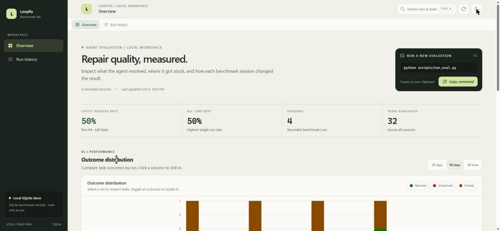

# Loopfix

An agentic AI coding agent that takes a GitHub repo and a bounded engineering task, investigates the codebase using tools, makes a targeted code fix, runs tests in an isolated Docker sandbox, iterates on failures (bounded), and produces a diff + written report — paired with a real evaluation harness that measures the agent's actual success rate on a small benchmark of tasks.

## Scope (MVP)

- **Task type**: fix failing tests in a Python repo after a dependency/library version bump.
- **Agent**: single agent loop with tool calling (Groq), not multi-agent.
- **Retrieval**: ripgrep + a lightweight JSON symbol index, not a vector DB.
- **Sandbox**: one Docker container per task run, real isolation, hard timeout, no network during test execution.
- **Output**: git diff + written report (root cause, changes, test results, confidence). No auto-PR in the MVP.
- **Storage**: SQLite.
- **Eval**: an 8-12 task benchmark of real dependency-bump breakages, run for real, with honest reported numbers.

## Status

Steps 1-7 of the build order are implemented and validated. Latest real benchmark run (2026-09-03, `eval_runs.id=4` in `loopfix.db`): **4/8 tasks resolved (50%)**, all in 1-3 `run_tests` attempts. The other 4 tasks never got a full run — they errored out on Groq's free-tier rate limits (one 8000-TPM per-request cap hit, three 200k-TPD daily cap exhaustions) rather than failing on the actual fix attempt. See commit history for build progression: Docker sandbox first, then read-only tools, then the agent loop, then editing + the bounded debug loop, then the eval harness.

Known limitation: Groq's free tier caps a full 8-task run at roughly its entire daily token budget, so a same-day clean 8/8 run isn't realistic without a paid tier or a smaller per-task prompt.

## Web dashboard



`webapp/` is a read-only viewer over `loopfix.db` and `logs/*.json` — the same data `scripts/run_eval.py` already produces. It never writes to either; it's a presentation layer, not part of the agent itself.

- **Backend** (`webapp/backend`): a small FastAPI app exposing `/api/runs`, `/api/runs/{id}`, and `/api/logs/{log_id}`.
- **Frontend** (`webapp/frontend`): a React + TypeScript + Tailwind dashboard (run history, outcome charts, run comparison, per-task tool-call traces and diffs, command palette, light/dark themes).

To run it locally, in two terminals from the project root:

```bash
# Terminal 1 - API, must be on port 8420 (the frontend dev server proxies /api to it)
python -m uvicorn webapp.backend.main:app --port 8420

# Terminal 2 - frontend
cd webapp/frontend
npm install
npm run dev
```

Then open the printed `localhost` URL (Vite's default is `http://localhost:5173`). See [`webapp/README.md`](webapp/README.md) for the full feature list (command palette, run comparison, per-task tool traces) and directory layout.

If you just want to inspect a single task log without running either server, `viewer/log_viewer.html` opens one `logs/*.json` file directly in the browser with no build step and no backend - a plain-file fallback, not a replacement for the dashboard above.

## Build order

1. Docker sandbox (clone → run tests in container → confirm isolation & timeout)
2. Read-only tools: `search_text`, `search_symbol`, `read_file`, `list_directory`
3. Agent loop, investigation-only (no editing yet)
4. `edit_file` + `run_tests` + bounded 5-iteration debug loop
5. Structured JSON execution log + simple log viewer
6. Diff + report generation
7. 8-12 task benchmark + eval runner, run for real
8. Stretch goals (only after 1-7 are solid)
